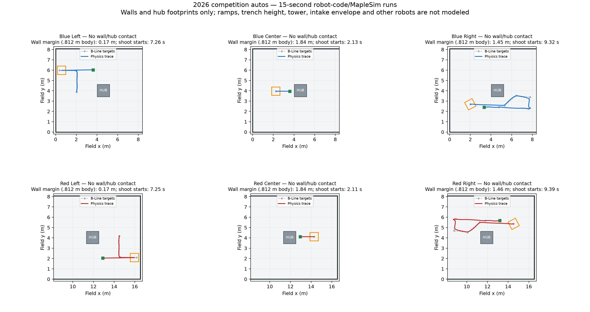

# Competition auto simulation — 2026-10-30

All six final 15-second runs reached the shooting phase and commanded feeding. No wall or hub contacts were detected with the simulator body. These are robot-code/MapleSim runs, not B-Line GUI kinematic previews. Nothing was deployed.

## Changes applied before running

- Disabled every competition-path profiled rotation, including standalone rotation targets. Red paths inherit these settings through the 180-degree transform.
- Set intermediate waypoint handoff radii to 0.30 m, including the explicit 0.40 m and 0.45 m overrides. Final endpoint translation tolerance remains 0.03 m.
- Disabled profiled rotation on the generated backup waypoints too. The backup was unit-checked; the six primary paths were physics-simulated.
- Retained the existing B-Line PIDs, segment speed constraints, path coordinates and events.

## Final run results

| Auto | Shooting phase begins | Gated feed time | Minimum wall margin, 0.812 m square check | Model wall/hub contact samples |
| --- | ---: | ---: | ---: | ---: |
| Blue Left | 7.26 s | 7.32 s | 16.8 cm | 0 / 0 |
| Blue Center | 2.13 s | 12.72 s | 184.1 cm | 0 / 0 |
| Blue Right | 9.32 s | 5.58 s | 145.2 cm | 0 / 0 |
| Red Left | 7.25 s | 7.38 s | 16.5 cm | 0 / 0 |
| Red Center | 2.11 s | 12.74 s | 184.2 cm | 0 / 0 |
| Red Right | 9.39 s | 5.48 s | 145.9 cm | 0 / 0 |



## Findings that still matter on the robot

1. **Left intake-to-wall clearance is unverified.** The left autos approach the alliance wall with the intake requested extended and the front facing the wall. The conservative bumper check leaves only about 16–17 cm. Forward intake protrusion beyond that bumper envelope can consume this clearance and hit the wall. No deployed-intake dimensions are configured, so the simulator cannot rule this out.
2. **The center starting pose is tight to the hub for a larger robot.** At the authored start, a 0.812 m square footprint has approximately 1.36 cm of hub clearance. The simulator body is smaller (its dimensions come from YAGSL track dimensions plus 5 inches), so its no-contact result does not establish adequate placement margin for the actual bumpers.
3. **Right autos leave about 5.5 seconds of simulated feeding.** They reach shooting at roughly 9.3 seconds. Verify a full basket empties in the available time; the simulation does not model fuel count, jams, or flywheel speed dips from ball impacts.
4. **Bump traversal, trench height, tower/depot structures, deployed intake collision and other robots are not modeled.** In particular, the human/right path crosses the bump region. These runs cannot validate ground clearance, tipping, suspension response or intake contact on the ramp.

## Simulator setup and limits

YAGSL 2026.1.12 bundles MapleSim with a default 2025 Reefscape arena. Using that field would create false collisions for these 2026 paths. The competition headless diagnostic replaces it with a 16.54 m × 8.07 m rectangular boundary and two 47-inch-square hub bodies at the centers in FieldConstants. Field and hub dimensions reference the [official 2026 game manual](https://firstfrc.blob.core.windows.net/frc2026/Manual/HTML/2026GameManual.htm). This is a partial planar collision model, not a complete 2026 field.

The final runs spawn the physical body at the selected first waypoint before physics starts. Preliminary runs used the old testing spawn, which slightly overlapped the blue hub before the auto pose reset and could leave stale collision-solver effects. Preliminary evidence is preserved outside verified/; use only verified/ for the final results.

Physics-body pose was sampled directly at robot-loop frequency. The CSV also records oriented 0.812 m square wall clearance as a conservative comparison, hub separation for the actual simulation body, shooting/feeding phase and measured speed. The larger square is an assumption, not a measured bumper envelope. Minimum clearances are sampled approximations, not a swept-volume certificate. Gated feeding time sums enabled feed samples and is approximate when desktop loops overrun.

## Reproduce

```sh
python3 tools/run-competition-simulation.py --output artifacts/competition-auto-simulation/new-run
# Plotting requires matplotlib in your Python environment:
python3 tools/analyze-competition-simulation.py artifacts/competition-auto-simulation/new-run
```

Each final run directory contains console output, a WPILOG, trace.csv and summary.txt. verified/input-sha256.json records the path, constraints, PID/config and diagnostic source hashes used for the runs.
