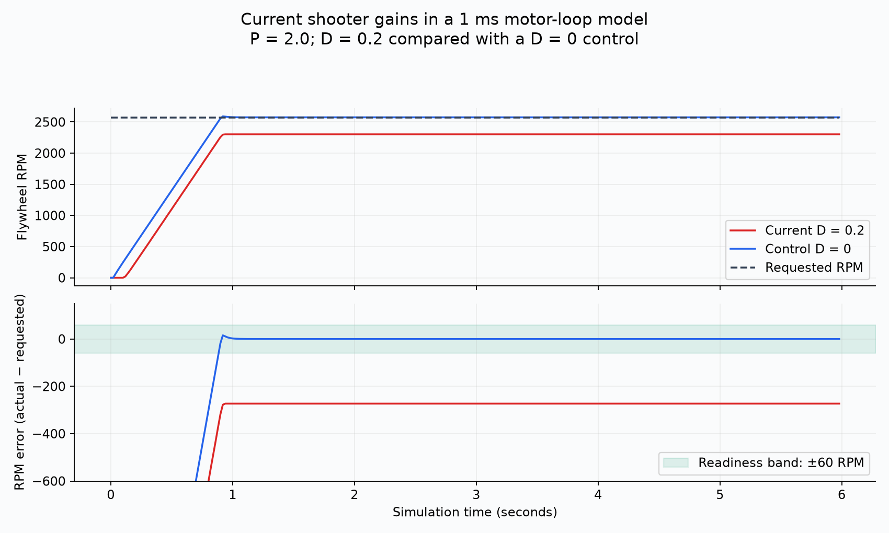
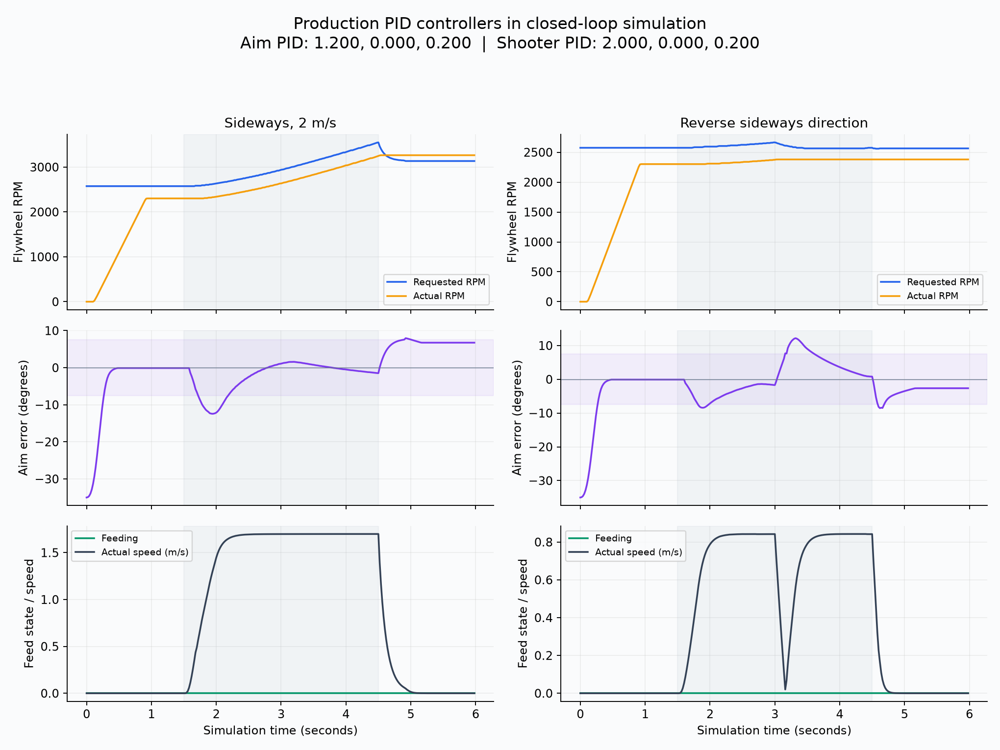
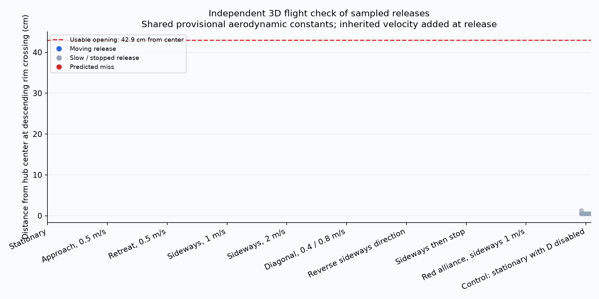

# Shoot-on-the-move closed-loop simulation

These are simulated outcomes, not measured robot hit rates. The production command and controller code ran at 20 ms against YAGSL/MapleSim drivetrain physics and WPILib FlywheelSim. No alignment or flywheel speed was mocked. Indexer readiness was idealized.

## Controller values and setup

```text
Aim PID: 1.200, 0.000, 0.200; angular limits: 12.500 rad/s, 24.000 rad/s^2
Aim tolerance: 7.500 deg; tracking-rate tolerance: 5.000 deg/s
Shooter PID: 2.000, 0.000, 0.200; FF kS=0.150000 kV=0.027932 kA=0.003836
Launch coefficient: 1.050; battery: 12.0 V; robot loop: 20 ms; motor loop: 1 ms; MapleSim substeps: 5
Indexer idealized ready; flat field; no vision noise, wheel impacts, supply sag, release delay or ball loading. Motor P/D stand-in omits firmware filtering and CAN latency.
```

The initial pose is 3.5 m from the hub with a 35-degree heading error. The extra stationary control case disables D only inside the simulator, retaining the same P and flywheel plant. Each scenario lasts 6 seconds: hold position for 1.5 seconds, ramp translation over 0.3 seconds, then stop at 4.5 seconds. The reversal and early-stop cases change direction or stop at 3 seconds. Labeled speeds are commands; the physical model can travel more slowly. The harness reads the PID values from the current robot configuration; it does not tune or overwrite them.

YAGSL uses simplified module motor loops rather than reproducing Talon firmware. The production hub-aim PID, angular profile, tracking feedforward, shooter P/D gains, voltage feedforward, current-limited flywheel plant with a 1 ms unfiltered software motor-loop stand-in, acceleration limiter, and feed dwell all run directly. The simulated field is flat with no obstacles. Battery is fixed at 12 V; ball impacts, inventory, flywheel droop from shots, vision noise, and release-delay uncertainty are absent.

## Results

In the final second of the stationary test, the requested speed averaged 2575 RPM. The current P/D model averaged 2302 RPM; the same-plant D=0 control averaged 2575 RPM. The feed gate requires measured speed within 60 RPM of the goal. The 1 ms derivative model is unfiltered and does not reproduce Talon firmware.



| Scenario (commanded speed) | Actual moving speed, median | First feed | Feed open while moving | All sampled scores / releases | Moving scores / releases | Largest miss from center |
|---|---:|---:|---:|---:|---:|---:|
| Stationary | 0 m/s | Never | — | 0 / 0 | — | No releases |
| Approach, 0.5 m/s | 0.41 m/s | Never | 0% | 0 / 0 | 0 / 0 | No releases |
| Retreat, 0.5 m/s | 0.41 m/s | Never | 0% | 0 / 0 | 0 / 0 | No releases |
| Sideways, 1 m/s | 0.84 m/s | Never | 0% | 0 / 0 | 0 / 0 | No releases |
| Sideways, 2 m/s | 1.70 m/s | Never | 0% | 0 / 0 | 0 / 0 | No releases |
| Diagonal, 0.4 / 0.8 m/s | 0.75 m/s | Never | 0% | 0 / 0 | 0 / 0 | No releases |
| Reverse sideways direction | 0.84 m/s | Never | 0% | 0 / 0 | 0 / 0 | No releases |
| Sideways then stop | 0.84 m/s | Never | 0% | 0 / 0 | 0 / 0 | No releases |
| Red alliance, sideways 1 m/s | 0.84 m/s | Never | 0% | 0 / 0 | 0 / 0 | No releases |
| Control: stationary with D disabled | 0 m/s | 1.00 s | — | 25 / 25 | — | 1.3 cm |

Feed-open fraction uses only the 2–4.5 second interval and samples with actual speed above 0.15 m/s. It includes pauses for aiming, dwell, RPM, or an unreachable trajectory; it is not a ball throughput or success percentage. If present, first feed can occur during the initial stationary spin-up.

Releases are sampled at most once every 0.2 seconds while the feed gate is open. Every scenario samples releases before, during, and after translation. Moving releases are classified by actual speed above 0.15 m/s; all other sampled releases are stationary. The independent RK4 model integrates 3D gravity, quadratic drag and backspin lift after adding ground velocity at release. It shares the provisional aero/launch constants, so it can detect algorithm inconsistencies but cannot validate those constants against real balls. A separate stationary cross-check verifies the independent integrator against the existing model. The usable center-distance limit is 42.9 cm, with near-rim clearance and entry-angle checks also required.





## Finding and correction

The initial run released a predicted miss while slowing from the faster sideways command: approximately 70 cm from center. The readiness calculation used the requested heading and could overlook actual heading lag. The moving-only scoring gate now uses measured heading and measured RPM when predicting landing. Stationary calculation and readiness are unchanged. The initial before/after check used unchanged gains. During the work, the workspace shooter gains were edited from P=0.6, D=0 to P=2.0, D=0.2. The final results use the current values, with an explicit 1 ms P/D motor loop because the stock flywheel simulator ignores D. This stand-in omits firmware filtering, CAN latency and supply-current limiting; it is not an exact Talon simulation. The earlier P-only run is retained in `p-only-simulator/`. Original traces are in `before-heading-check/`.

The final run with the current P/D motor-loop model did not release any balls. The flywheel never satisfied the measured-speed readiness condition, including in the stationary case. The earlier P-only simulator run produced 64/64 passing moving samples and 4 misses after stopping, but it omitted the now-nonzero D gain and cannot validate the current settings. A 1 ms unfiltered P/D stand-in is not Talon firmware: this result flags sensitivity to D and requires a firmware-aware simulation or measured flywheel response before concluding how the hardware behaves.

## Timing

CSV traces contain wall time of command execution on this desktop, including trajectory selection, readiness, aiming, telemetry and JVM scheduling/JIT effects. These are not roboRIO timings or CPU-utilization percentages. Warmed later scenarios are more representative than the first stationary scenario; do not compare those directly as an overhead ratio.

## Reproduce

```sh
./gradlew movingShotSimulation
uv run --with matplotlib tools/analyze-moving-shot-simulation.py
```
