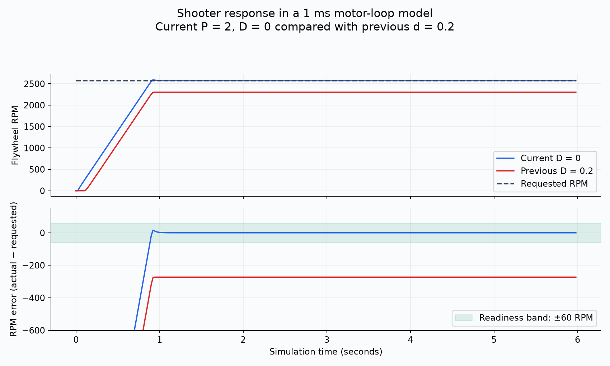
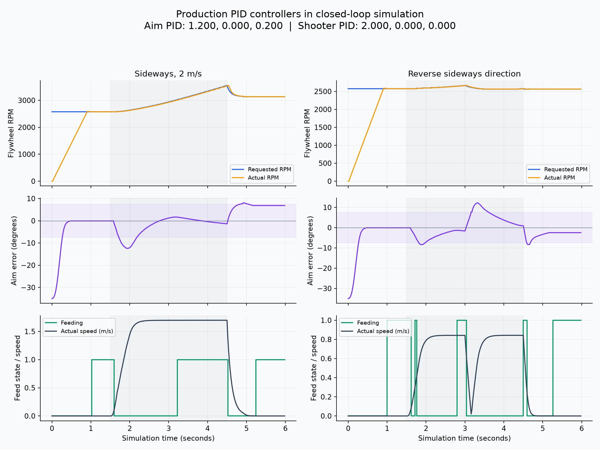
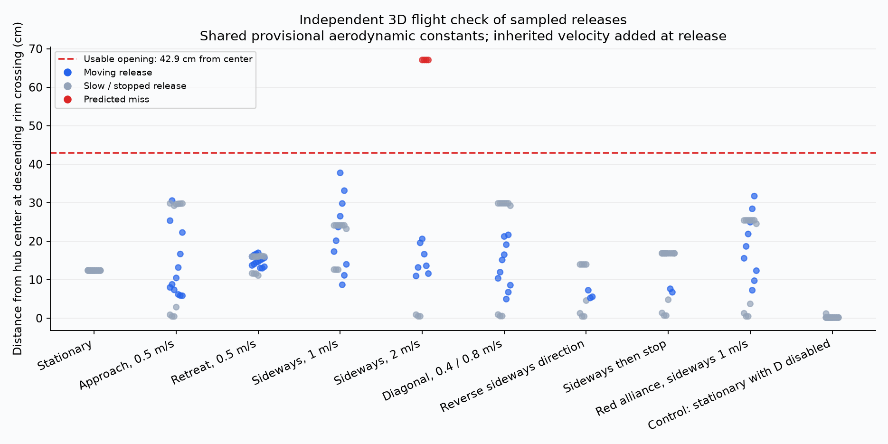

# Shoot-on-the-move closed-loop simulation

These are simulated outcomes, not measured robot hit rates. The production command and controller code ran at 20 ms against YAGSL/MapleSim drivetrain physics and WPILib FlywheelSim. No alignment or flywheel speed was mocked. Indexer readiness was idealized.

## Controller values and setup

```text
Aim PID: 1.200, 0.000, 0.200; angular limits: 12.500 rad/s, 24.000 rad/s^2
Aim tolerance: 7.500 deg; tracking-rate tolerance: 5.000 deg/s
Shooter PID: 2.000, 0.000, 0.000; FF kS=0.150000 kV=0.027932 kA=0.003836
Launch coefficient: 1.050; battery: 12.0 V; robot loop: 20 ms; motor loop: 1 ms; MapleSim substeps: 5
Indexer idealized ready; flat field; no vision noise, wheel impacts, supply sag, release delay or ball loading. Motor P/D stand-in omits firmware filtering and CAN latency.
```

The initial pose is 3.5 m from the hub with a 35-degree heading error. Each case lasts 6 seconds: hold for 1.5 seconds, ramp translation over 0.3 seconds, stop at 4.5 seconds. Reversal/early-stop cases change at 3 seconds. Labeled speeds are commands. The extra stationary control disables D only in the simulator. No gains are tuned by this harness.

YAGSL uses simplified module motor loops rather than reproducing Talon firmware. The production hub-aim PID, angular profile, tracking feedforward, shooter P/D gains, voltage feedforward, current-limited flywheel plant with a 1 ms unfiltered software motor-loop stand-in, acceleration limiter, and feed dwell all run directly. The simulated field is flat with no obstacles. Battery is fixed at 12 V; ball impacts, inventory, flywheel droop from shots, vision noise, and release-delay uncertainty are absent.

## Results

In the final second of the stationary test, the requested speed averaged 2575 RPM. The current P/D model averaged 2575 RPM; the previous d = 0.2 run averaged 2302 RPM. The feed gate requires measured speed within 60 RPM of the goal. The simulation does not reproduce Talon firmware filtering or CAN latency.



| Scenario (commanded speed) | Actual moving speed, median | First feed | Feed open while moving | All sampled scores / releases | Moving scores / releases | Largest miss from center |
|---|---:|---:|---:|---:|---:|---:|
| Stationary | 0 m/s | 1.00 s | — | 25 / 25 | — | 12.4 cm |
| Approach, 0.5 m/s | 0.41 m/s | 1.02 s | 91% | 22 / 22 | 12 / 12 | 30.6 cm |
| Retreat, 0.5 m/s | 0.41 m/s | 1.00 s | 100% | 25 / 25 | 14 / 14 | 17.0 cm |
| Sideways, 1 m/s | 0.84 m/s | 1.02 s | 66% | 20 / 20 | 10 / 10 | 37.8 cm |
| Sideways, 2 m/s | 1.70 m/s | 1.02 s | 51% | 10 / 14 | 7 / 7 | 67.1 cm |
| Diagonal, 0.4 / 0.8 m/s | 0.75 m/s | 1.02 s | 66% | 20 / 20 | 10 / 10 | 29.8 cm |
| Reverse sideways direction | 0.84 m/s | 1.00 s | 10% | 11 / 11 | 3 / 3 | 14.0 cm |
| Sideways then stop | 0.84 m/s | 1.00 s | 28% | 17 / 17 | 2 / 2 | 16.8 cm |
| Red alliance, sideways 1 m/s | 0.84 m/s | 1.00 s | 68% | 20 / 20 | 9 / 9 | 31.7 cm |
| Control: stationary with D disabled | 0 m/s | 1.00 s | — | 25 / 25 | — | 1.2 cm |

Feed-open fraction uses only the 2–4.5 second interval and samples with actual speed above 0.15 m/s. It includes pauses for aiming, dwell, RPM, or an unreachable trajectory; it is not a ball throughput or success percentage. If present, first feed can occur during the initial stationary spin-up.

Releases are sampled at most once every 0.2 seconds while the feed gate is open. Every scenario samples releases before, during, and after translation. Moving releases are classified by actual speed above 0.15 m/s; all other sampled releases are stationary. The independent RK4 model integrates 3D gravity, quadratic drag and backspin lift after adding ground velocity at release. It shares the provisional aero/launch constants, so it can detect algorithm inconsistencies but cannot validate those constants against real balls. A separate stationary cross-check verifies the independent integrator against the existing model. The usable center-distance limit is 42.9 cm, with near-rim clearance and entry-angle checks also required.






## Findings

The moving-only scoring gate uses measured heading and RPM after an initial diagnostic exposed a stopping error. Shooter D was set to zero as requested while retaining P=2. Earlier data is retained in the archived run folders.

The configured P=2, I=0, D=0 run produced 67/67 passing moving samples and 170/174 passing samples overall, excluding the duplicate stationary control. Releases after stopping can miss because the preserved stationary 7.5-degree heading tolerance allows too much angular error at longer ranges. Feed continuity still drops during reversals and faster sideways motion. These results are simulated checks, not a physical success rate.

## Timing

CSV traces contain wall time of command execution on this desktop, including trajectory selection, readiness, aiming, telemetry and JVM scheduling/JIT effects. These are not roboRIO timings or CPU-utilization percentages. Warmed later scenarios are more representative than the first stationary scenario; do not compare those directly as an overhead ratio.

## Reproduce

```sh
./gradlew movingShotSimulation
uv run --with matplotlib tools/analyze-moving-shot-simulation.py --comparison artifacts/moving-shot-simulation/d-0p2-motor-loop
```
